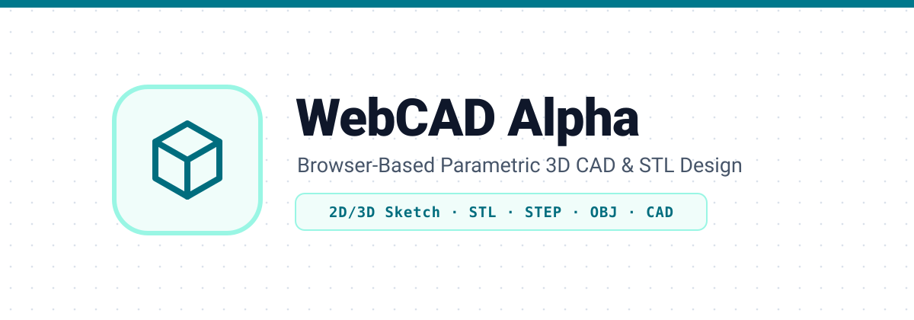

 

  
  
  

  
  
  
  

---

> **About this repository:**
> This is the official public hub for **WebCAD Alpha** announcements, release notes ([CHANGELOG.md](./CHANGELOG.md)), roadmap, bug reports, and feature requests. The application source code is maintained in a private repository.

---

## Key Features

| Category | Highlights |
| :--- | :--- |
| **2D & 3D Sketching** | Parametric 2D/3D sketching on standard & custom planes, snap grid, live previews, and interactive tools |
| **Solid Modeling** | Extrude, Revolve, Hole, Fillet, Chamfer, Shell, Boolean CSG operations, and Section Plane inspection |
| **Live Materials & ViewCube** | Real-time material switching (`Steel`, `Aluminum`, `Brass`, `Polymer`, `Gold`) and interactive 3D ViewCube |
| **3D Printing & CAD Export** | Export directly to **STL**, **STEP**, **OBJ**, and native **CAD / JSON** formats |
| **Bilingual Interface** | Instant live switching between **English** and **Turkish** (including UI, status bar, and 3D ViewCube labels) |
| **Zero Installation** | Runs directly in modern desktop and mobile browsers via WebGL |

---

## Plans

- **Free Plan:** Sign in with Google or a verified email address — includes **3 file downloads per day** (resets daily at `00:00 UTC`).
- **Supporter Plan:** Support development on [Buy Me a Coffee](https://buymeacoffee.com/burakzahter) for **unlimited downloads** (automatically activated for your account email).

---

## Community & Feedback

Found a bug or have an idea for a new CAD tool?

- **[Report a Bug](https://github.com/IIIMrRobotIII/webcad-alpha/issues/new?template=bug_report.md)**
- **[Request a Feature](https://github.com/IIIMrRobotIII/webcad-alpha/issues/new?template=feature_request.md)**
- **[View Changelog](./CHANGELOG.md)**

---

## Roadmap

- [x] 2D/3D parametric sketching & solid modeling kernel
- [x] STL, STEP, OBJ, and CAD project import/export
- [x] Full bilingual interface (EN & TR) + live ViewCube & materials
- [x] Account system, daily quota, and automated Supporter tier
- [ ] Advanced sketch constraints & dimensioning tools
- [ ] Multi-part assemblies & cloud project library
- [ ] Performance optimizations & additional export options

---

## Developer

Created and maintained by **Mehmet Burak Zahter** ([@IIIMrRobotIII](https://github.com/IIIMrRobotIII)).

If WebCAD Alpha helps your 3D printing or CAD workflow, consider supporting its development:

